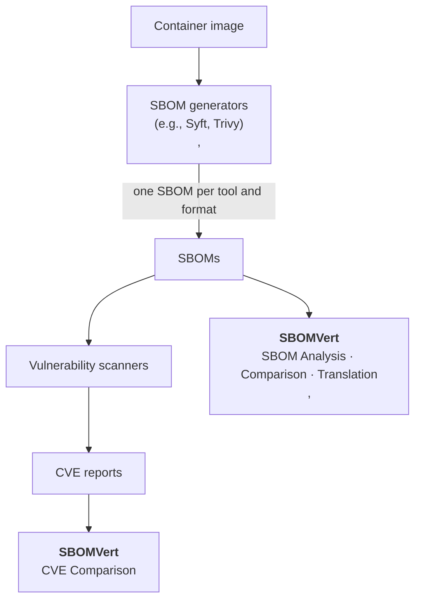

# What is SBOMVert?

SBOMVert is a web application for comparing **SBOMs** (Software Bills of Materials) and **CVE reports** produced by different tools for the same container image. It can also translate an SBOM so that it looks as if another tool had written it, in SPDX or CycloneDX.

It is based on the research published at [arxiv.org/abs/2510.05798](https://arxiv.org/abs/2510.05798).

## The problem: tools disagree

SBOM generators and vulnerability scanners rarely agree. Run two tools against the same image and you can get:

- **Different package lists.** One tool finds a dependency another misses, or the tools name and version the same package differently.
- **Different metadata.** Suppliers, licenses, hashes, Package URLs (pURLs) and CPEs are filled in differently, or not at all.
- **Different vulnerability findings.** Scanners disagree on which CVEs affect a package, partly because they read different SBOMs.

Swapping one tool for another, or feeding one tool's SBOM into another tool's scanner, is rarely lossless. SBOMVert normalizes the reports into a common model and shows, package by package, where they agree and where they do not. See [Why tools disagree](/concepts/tool-disagreement) for the details.

## Who it is for

- Security engineers who need to know how much to trust a single tool's SBOM or CVE report.
- Platform and DevSecOps teams choosing an SBOM generator or scanner for a pipeline.
- Researchers measuring SBOM quality and tool agreement across many images.
- Anyone who has an SBOM from one tool and needs it in another tool's style or another format.

## What you can do

| Page | What it does | Needs a server |
| --- | --- | --- |
| **SBOM Analysis** | Open a stored SBOM, or load your own (file or pasted JSON), and browse its packages, licenses and metadata. [Try it](https://sbomvert.jackops.dev/compare/analyze/). | No (stored SBOMs need one) |
| **SBOM Comparison** | Compare the SBOMs that different tools produced for one image: package overlap, charts, metadata conflicts. | Yes |
| **CVE Comparison** | Compare the CVE reports that different scanners produced for one image, package by package. | Yes |
| **Translate SBOM** | Rewrite an SBOM (pasted, from a file, or stored) the way another tool writes it, in SPDX or CycloneDX. [Try it](https://sbomvert.jackops.dev/translate/). | No (stored SBOMs need one) |
| **Scan** | Generate SBOMs and CVE reports for a container image on demand. Experimental, off by default. | Yes, but needs scan worker |
| **Upload SBOM** | Add an SBOM to the stored dataset so it shows up in the comparison pages. Off by default. | Yes |

## Three ways to run SBOMVert

The same app runs in three modes. Each adds to the one before it.

| Mode | What runs | Pages | Try or set up |
| --- | --- | --- | --- |
| **1. Static** (browser only) | Plain HTML and JavaScript on any static host. No server, no storage. | SBOM Analysis and Translate SBOM, for SBOMs you paste or pick from a file. They never leave your browser. | Try it at [sbomvert.jackops.dev](https://sbomvert.jackops.dev), or build your own: [Static build](/guides/static-build) |
| **2. Server** (default) | The Next.js app, reading reports from a local folder or S3. | Everything in mode 1, plus stored SBOMs, SBOM Comparison and CVE Comparison. Upload SBOM when `NEXT_PUBLIC_ENABLE_SBOM_UPLOAD=true`. | [Installation](/getting-started/installation), [Add your own reports](/guides/add-reports) |
| **3. Server with live scans** | The app, Redis and the scan worker. Optionally Postgres, for sign-in. | Everything in mode 2, plus **Scan**: SBOMs and CVE reports generated on demand. | [Live scans](/guides/live-scans) |

Choose mode 1 to inspect or translate a single SBOM, mode 2 to compare reports you already have, and mode 3 to generate those reports from SBOMVert.

## How it fits together

SBOMVert does not need to run any scanner itself. Usually you generate reports elsewhere and point SBOMVert at them:

The optional live scan feature runs this whole chain for you: a scan worker generates the SBOMs, scans them, and the app stores the results in the same layout. See [Live scans](/guides/live-scans).

## Supported tools in short

- **SBOM generators** (live scans and the comparison pages): Syft, Trivy, Docker Scout, Amazon Inspector SBOM Generator, OSV-Scanner and cdxgen, in SPDX and/or CycloneDX depending on the tool.
- **Vulnerability scanners**: Trivy and Grype (Grype scans Syft's SBOM).
- **Translation**: SBOMs in the style of Syft, Trivy, Docker Scout, Google Artifact Analysis, Amazon Inspector and Microsoft's sbom-tool.

The comparison pages read any SPDX or CycloneDX JSON SBOM; the tool list matters for live scans and translation. The full matrix is in [Supported tools](/getting-started/#supported-tools-in-short).

## Related

- [Quickstart](/getting-started/quickstart)
- [Installation](/getting-started/installation)
- [Tutorial: your first comparison](/getting-started/first-comparison)
- [Why tools disagree](/concepts/tool-disagreement)
